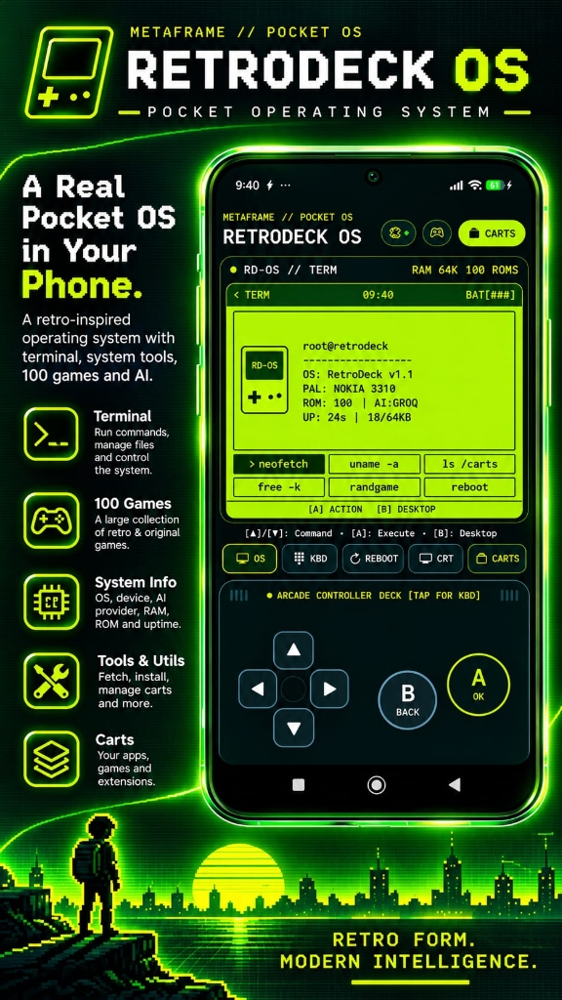

<div align="center">

# RetroDeck OS & Arcade

**100-in-1 60 FPS Pocket Console • Authentic Nokia 3310 Firmware OS • 100 Hardware & LCD Themes • Live SomaFM Radio • OS-Controlling BYOK AI • Live Persona SMS & Postcard Studio • Contacts • EN/TR i18n**

[](https://expo.dev/)
[](https://reactnative.dev/)
[](https://www.typescriptlang.org/)
[](https://www.metaframelabs.space/)


<br />



</div>

Built by **[MetaFrame Labs](https://www.metaframelabs.space/)** — Zero WebViews, pure TypeScript deterministic 60 FPS engine running inside a 4:3 monochrome / phosphor dot-matrix LCD screen, complete with a full **Nokia 3310 Operating System (`RetroDeck OS`)**, a 3-mode hot-swappable **Gamepad (`PAD`) ↔ Nokia 3×4 Numeric (`NUM`) ↔ Communicator QWERTY (`KBD`)** deck, **100 playable 60 FPS cartridges**, **100 persistent full-hardware themes**, **live SomaFM streaming radio**, **Open-Meteo weather**, **interactive Unix shell (`rdsh`)**, **★ Favorites**, and an in-app **Custom Game Studio** compiler.

---

## 📱 RetroDeck OS (Nokia 3310 Desktop Environment)

Boot cleanly into a 3.5s BIOS sequence (`[A]`/`[B]` skippable) with cellular signal bars, live battery telemetry (`expo-battery`), operator logos, keyguard lock screen with floating analog/digital clock & unread SMS indicator, and a **17-app Desktop grid** plus dedicated **`THEMES`** and **`PRO`** in-LCD modules:

| App | Module | Description |
| :--- | :--- | :--- |
| **`GAMES`** | Arcade Browser | Browse and hot-boot all **100 built-in 60 FPS retro cartridges** (Top 10 classics free-first, Pro gating, persistent high scores, `★ Favorites`). |
| **`RADIO`** | SomaFM Live | Streams **10 SomaFM channels** (`Space Station`, `DEF CON Radio`, `Groove Salad`, `Vaporwaves`, `Secret Agent`, `Cliqhop IDM`, `Synphaera`, `Drone Zone`, `Lush`, `Suburbs of Goa`) with live *Now Playing* metadata, animated spectrum bars, independent volume control, and background playback. |
| **`CHAT`** | BYOK OS-Control AI | **9-provider AI assistant** (`Google Gemini`, `OpenAI`, `Anthropic Claude`, `Groq LPU`, `DeepSeek`, `xAI Grok`, `OpenRouter`, `Ollama Local`, `LM Studio`). Can **control RetroDeck OS directly** via `[[ACTION:...]]` tags (launch games, open apps, switch themes, tune radio, fetch weather, add notes, switch `EN/TR` language, lock keyguard, trigger live SMS, reboot), supports chat history clearing (`[◀]x2` or `/clear`), and strips emojis/Markdown for clean LCD rendering. |
| **`WAP`** | Nokia WAP 1.1 | Connects to live HTTPS pages with a `Nokia3330/1.0 (RetroDeckOS WAP 1.1)` User-Agent, parses HTML into 33-column monochrome WML cards, includes bookmarks, and defaults to `https://www.metaframelabs.space/`. |
| **`MUSIC`** | Nokia Composer | Real-time square-wave piezo buzzer synthesizer supporting Nokia Composer notation (`8e2 8d2 4f#1...`), **16 built-in ringtones**, scrollable **`♫ TUNES`** list, **`★ RING`** assignment, and **3 persistent custom tune slots (`MY TUNE 1–3`)** with keyboard rename (`[◀]`) & clear (`[▶]x2`). |
| **`PHONE`** | Dialer & Codes | Live DTMF tones, large-digit dialer (`NUM`) / 4×4 matrix (`PAD`), **Contacts caller-ID matching**, continuous looping incoming ring (`RING`), and Nokia service codes (`*#0000#`, `*#06#`, `*#92702689#` 5-page `*#WAR0ANTY#`, `*#7780#`, `*#7370#`). |
| **`CONTACTS`** | Phonebook | Synced SIM/AI phonebook with all 9 Live SMS personas + custom saved contacts (`@retrodeck8_contacts_v1`). Browse (`▲/▼`), 1-tap **Call** (`[A]`), direct **SMS / AI Reply** (`[▶]`), add new contact (`[KBD]` or `+ ADD`), and delete custom entries (`[◀]x2` / `DEL`). |
| **`SMS`** | Live AI SMS & Postcard Studio | **1) Live AI Persona & Promo SMS (`EN/TR`):** Background & on-demand scheduler with 9 distinct personas/ads, timestamps, dynamic moods, 35% unexpected twists, per-persona 12-turn memory, Gemini/Claude role normalization, and anti-repeat similarity protection + `[A]` direct reply.<br>**2) 2-Page Postcard Studio (`[▲]`):** Compose with **13 bespoke 16-bit pixel-art postcard scenes** (`assets/postcards/*.jpg`) and **130+ vector `Ionicons` stamps**, plus Morse `"S-M-S"` & custom SMS alert tones. |
| **`PROFILE`** | Audio & Keyguard | Switch profiles (`GENERAL`, `SILENT`, `MEETING`, `OUTDOOR`), volume (`0–100%`), **16 Ringtones**, **5 SMS Tones**, **6 Key Sound Styles**, operator names, LCD Torch invert, and Keyguard lock (`[A]` then `[▲]` to unlock). |
| **`CALC`** | Calculator | Precision arithmetic (`+`, `-`, `×`, `÷`, `.`, `DEL`, `C`, `=`) with full D-pad & `NUM` keypad support. |
| **`CLOCK`** | Timepiece | 3-tab watch (`1.CLOCK`, `2.STOPWATCH`, `3.TIMER`) with rotating circular **Analog Clock** or **Digital** face, lap stopwatch, and countdown ringtone alarm. |
| **`PAINT`** | Pixel Art Studio | **16×10 monochrome pixel editor** loaded with a **6-artwork gallery** (`STARRY NIGHT`, `MT. FUJI`, `SAILBOAT`, `RETRO CASTLE`, `SPACE INVADER`, `ROCKET SHIP`), navigable bottom toolbar (`[◀ ART]`, `[ART ▶]`, `[INV]`, `[CLR]`), and direct pixel drawing. |
| **`WEATHER`** | Live Weather | Zero-key **Open-Meteo** live current weather, feels-like/wind/humidity, 3-day mini forecast, and 60 FPS animated LCD sprites (`SUN`, `CLOUD`, `RAIN`, `STORM`, `SNOW`) + custom city search. |
| **`NOTES`** | Pixel Notepad | Persistent `AsyncStorage` notes (`@retrodeck8_notes_v1`) with preview header, keyboard creation, and double-tap delete (`[▶]x2`). |
| **`SHELL`** | Unix Shell (`rdsh`) | Interactive terminal supporting `help`, `neofetch`, `ls`, `cat`, `open <game>`, `randgame`, `play <song>`, `stop`, `wap <url>`, `contacts`, `ai <prompt>`, `livesms`, `lang [en\|tr]`, `theme`, `pro`, `lock`, `reboot`, `clear`. |
| **`STATS`** | Scoreboard | Tracks played cartridges, total points, and top high scores across all 100 games. |
| **`SETUP`** | System & Pro | Manage **RetroDeck Pro (`PRO`)**, open the 100-palette **`THEMES`** browser, toggle **CRT Scanlines**, **Clock Face**, **Live AI SMS**, **Language (`EN / TR`)**, launch **Cartridge Vault**, or **Reboot OS**. |

---

## 🌐 Internationalization (`src/i18n/`)

Clean **SOLID** i18n layer defaulting to **English (`en`)** with instant **Turkish (`tr`)** switching in `SETUP` or `SHELL` (`lang en` / `lang tr`):
- **`src/i18n/types.ts`** & **`src/i18n/I18nService.ts`**: Injectable `AsyncStorage` persistence (`@retrodeck8_lang_v1`), OCP locale registry (`LOCALES`), and reactive subscription listeners.
- **`src/i18n/locales/en.ts`** & **`tr.ts`**: Compile-time schema-checked bundles (`LocaleBundle`) covering OS apps, desktop, keyboard hints, Live AI SMS personas/moods/twists, and all outer React UI modals & decks (`useTranslation` hook).

---

## 🎮 3-Mode Hardware Deck (`PAD` ↔ `NUM` ↔ `KBD`)

Switch between three hardware decks in `App.tsx`:
1. **`PAD` (`RetroKeypad`):** Wide cross D-pad, `A` / `B` buttons, Turbo-A bumper (`R`), Mute bumper (`L`), `SELECT`/`DECK`, `OK`, `START`, `HOME`/`GAME`.
2. **`NUM` (`RetroNumericDeck`):** Nokia 3×4 keypad (`0–9`, `*`, `#`) + top `[ ◀ ▲ ▼ ▶ ]` Navi-Row, `DEL`, `BACK`, `OK`, and `KBD` toggle.
3. **`KBD` (`RetroKeyboardDeck`):** Full QWERTY communicator keyboard with native paste bar for AI Chat, BYOK keys, WAP URLs, SMS/Contacts, Notes, and Shell.

---

## 🎨 100 Themes & 100 60 FPS Cartridges

- **Theme Studio (`src/theme/palettes.ts` & `ThemePickerModal.tsx`):** 100 full hardware + LCD themes (`HANDHELD`, `CRT`, `NEON`, `STUDIO`, `PAPER`, plus `★ FAVS`), with the top 10 classics free-first and full VIP unlocking.
- **100 Retro Cartridges (`src/arcade/cartridges.ts` & `src/arcade/games/*.tsx`):** Top 10 iconic classics free-first + 90 additional arcade cartridges, persistent high scores (`HighScoreService`), unified **Cartridge Ready** & **Game Over** overlays, plus live JavaScript compilation in **Custom Game Studio (`DevCartModal.tsx`)**.
- **In-LCD VIP & Release Safety (`src/services/revenueCatService.ts`):** Integrated RevenueCat SDK with in-LCD Monthly / Yearly / Lifetime packages, Restore Purchases, and release-build `test_` key safety guards (`UNLOCK_ALL_PRO_FOR_BUILD` flag for local release testing; set to `false` before App Store / Play Store release).

---

## 🗂️ Project Structure

```text
├── App.tsx                         # Main console shell, 60 FPS loop & 3-mode deck host
├── assets/postcards/               # 13 pixel-art postcard illustrations
└── src/
    ├── arcade/                     # 100 games, CHIP-8/custom compiler & ArcadeScreen
    ├── audio/RetroAudioEngine.ts   # Procedural 8-bit 22,050 Hz PCM WAV synthesizer
    ├── components/                 # CartridgeBayPage, ThemePickerModal, DevCartModal, Decks
    ├── i18n/                       # SOLID EN/TR i18n service, hook & locale bundles
    ├── os/
    │   ├── RetroDeckOS.tsx         # OS state core, storage hydration & delegator
    │   ├── retroOsData.ts          # Constants, bitmaps, postcards, tunes & contacts data
    │   ├── retroOsStyles.ts        # Monochrome LCD StyleSheet definitions
    │   ├── engine/                 # input, keyboard, shell (rdsh), AI/SMS/WAP/weather
    │   └── render/                 # core, comms (Phone/Contacts/SMS/AI/WAP) & media/tools
    ├── services/                   # byokAiService, revenueCatService, somaRadioService
    └── theme/palettes.ts           # 100 hardware & LCD palettes
```

---

## 🚀 Getting Started

```bash
# Clone the repository
git clone https://github.com/neurodivergent-dev/retrodeck-arcade.git
cd retrodeck-arcade

# Install dependencies
npm install

# Run TypeScript verification
npx tsc --noEmit

# Start Expo / Metro bundler
npx expo start

# Build standalone offline debug APK for Android
npx expo export:embed --platform android --dev false --entry-file index.ts --bundle-output android/app/src/main/assets/index.android.bundle --assets-dest android/app/src/main/res
cd android && ./gradlew assembleDebug
```
